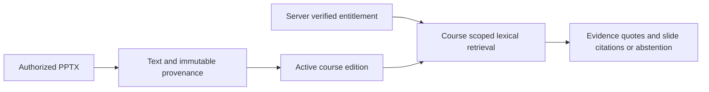

> **Proprietary - All Rights Reserved.** Licensed to Sandeep Grover. No reuse, copying, modification, or distribution without prior written permission. See LICENSE.

# Medical slide citation audit

A small, runnable **synthetic provenance demonstration**, not a deployed medical chatbot or clinical advice system. No patient data, client slides, clinical facts, API keys or paid model calls are included.

## Run

Python 3.10+:

```sh
python -m venv .venv
.venv/bin/pip install -r requirements.txt
.venv/bin/python main.py
.venv/bin/python -m pytest -q
```

The program extracts visible text from a minimal OOXML fixture in presentation order, preserves slide number/deck hash/course edition, checks a trusted entitlement fixture before retrieval, returns quoted evidence, and replaces an active annual release. The fixture is for parser tests, not a polished PowerPoint presentation.



## What the demonstration establishes

- Presentation ordering follows relationships, not slide filenames.
- Citations include course, edition, filename, slide number and SHA-256.
- Wrong-course, unpaid and expired entitlement fixtures fail before index access.
- Course-scoped retrieval does not mix evidence from another course.
- A newly activated release replaces old-version search results.
- An unmatched or empty query abstains.

## Deliberate boundaries

Retrieval is deterministic token overlap, **not embeddings, an LLM, a clinical answer generator or semantic faithfulness evaluation**. It can match irrelevant text sharing a token. No accuracy claim or clinical validation is made. The entitlement object represents trusted server output; it is not authentication, payment verification or a production access-control implementation. Production would verify identity/session and current course purchase on a trusted backend. No UI, website integration, concurrency, real payment system, OCR, charts, tables, speaker notes or adversarial upload hardening is implemented. Inputs must be trusted small files; production needs archive/XML size and resource limits, sandboxed ingestion and content sanitization.

## Proposed production checks

Audit representative decks and existing website/SSO; establish image/table coverage and rights; implement editioned hybrid retrieval and reranking; generate concise evidence-constrained answers with exact slide citations; test unsupported clinical questions and contradictory editions with clinician-reviewed questions. Treat slide content as untrusted model input, never executable instructions. Validate entitlement on every request, restrict citation downloads, rate-limit, monitor cost and allow annual release rollback. Medical-education use and the handling of any personal data require agreed product boundaries and review.

The demo is implementation evidence for a narrow audit component, not evidence of prior medical-chatbot delivery or production-scale throughput.
